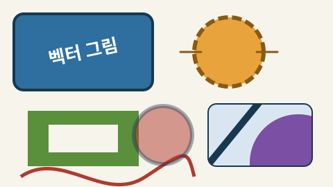

# SVG 그림

단색 채움과 선, 투명도만 쓰는 SVG는 EMF로 바뀝니다. [그림](#vector)은 벡터로 들어갑니다.

{#vector}

출처: md2hwp 시험 그림

그라데이션을 쓰는 SVG는 PNG로 바뀝니다. [그림](#gradient)이 그 예입니다.

{#gradient}

같은 SVG를 다시 쓰면 변환 파일 하나를 함께 씁니다.

