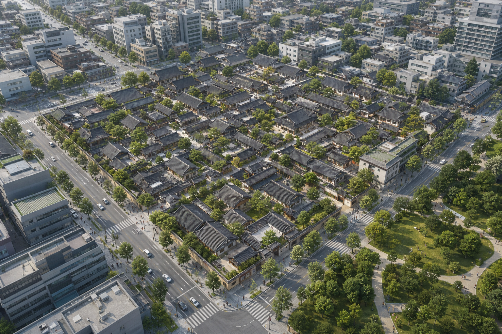

# 첫 장 {#첫장}

## 참조가 있는 절 {#첫절}

앞쪽 참조: [뒤쪽 그림](#그림둘), **[첫 그림](#그림하나)** 및 *[표](#표하나)*.
[장](#첫장), [절](#첫절), [다음 장](#다음장), [건너뛴 제목](#깊은제목)을 확인합니다.
각주[^참조각주]와 😀[첫 그림](#그림하나)[표](#표하나) 연속 참조입니다.

- 목록의 [그림](#그림둘) 참조입니다.
  - 중첩 목록의 [장](#다음장) 참조입니다.

](../../examples/all-features/image.png){#그림하나}

출처: [다음 그림](#그림둘), [다음 장](#다음장).

주1: [첫 그림](#그림하나) 자체 참조입니다.

Table: 표 캡션의 [그림](#그림둘) 및 [장](#첫장)

{#표하나}
| 대상 | 설명 |
| --- | --- |
| [그림](#그림둘) | **[표](#표하나)** 및 각주[^셀각주] |
| | [건너뛴 제목](#깊은제목) |

출처: [첫 그림](#그림하나), [절](#첫절).

```
제목: 리터럴 상호참조
[#그림하나]와 {{md2hwp:num:heading1}}는 그대로 둡니다.
```

출처: [표](#표하나)를 참고합니다.

# 다음 장 {#다음장}

## 다음 절

이 장의 [그림](#그림둘), 앞 장의 [그림](#그림하나), [표](#표하나)입니다.

#### 부모를 건너뛴 제목 {#깊은제목}

{#그림둘}

참고: [첫 장](#첫장), [표](#표하나), [그림](#그림하나).

[^참조각주]: 각주 안의 [그림](#그림둘), **[표](#표하나)** 및 [절](#첫절)입니다.

    다음 문단의 [장](#다음장)과 [그림](#그림하나)도 확인합니다.

[^셀각주]: 셀 각주의 [그림](#그림하나)와 [장](#다음장)입니다.
